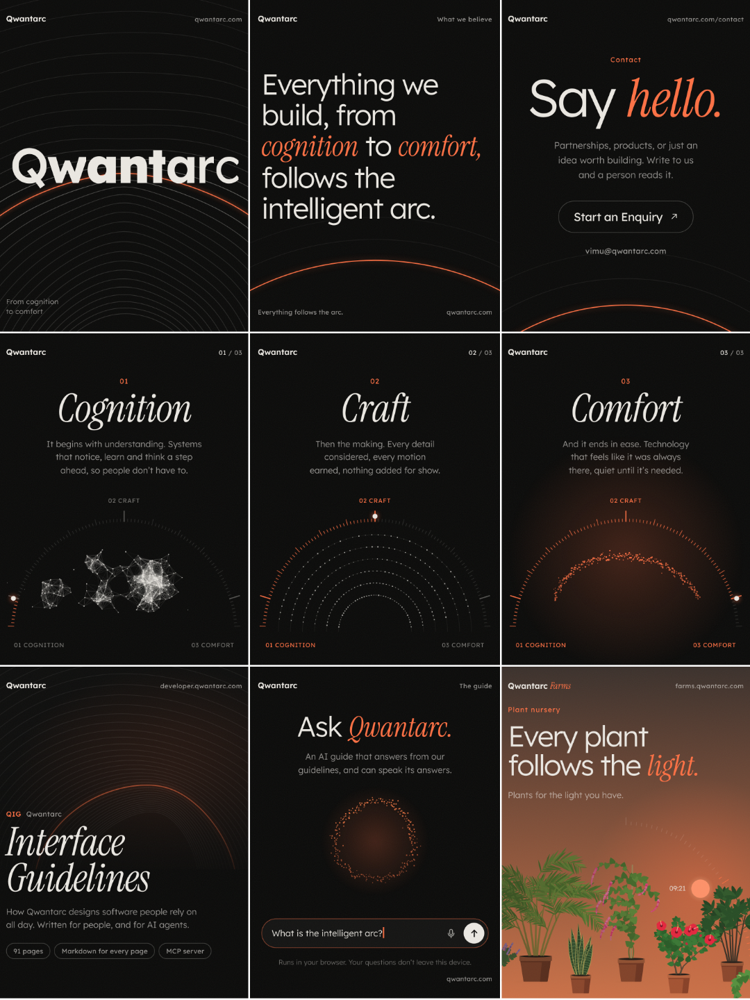

# Qwantarc on Instagram

A launch kit for the Qwantarc Instagram account: profile, a nine-post grid, a Reel, a Story and highlight covers.
Every image and video is drawn by the site’s own code (the arc field, the journey, the guide’s orb, the arc artwork and
the Farms garden), so the account looks and moves exactly like qwantarc.com.



## Profile

| Field             | Use                                                                                  |
| ----------------- | ------------------------------------------------------------------------------------ |
| Username          | `@qwantarc`                                                                          |
| Name              | Qwantarc                                                                             |
| Category          | Software company                                                                     |
| Profile picture   | `export/profile/profile-picture.png` (the Q from the favicon)                        |
| Contact button    | Email: vimu@qwantarc.com                                                             |

**Bio** (111 of 150 characters):

```
Everything we build, from cognition to comfort, follows the intelligent arc.
Write to us and a person reads it.
```

**Links** (Instagram allows five; the first one shows on the profile):

| Title                  | URL                              |
| ---------------------- | -------------------------------- |
| Qwantarc               | https://qwantarc.com             |
| Say hello              | https://qwantarc.com/contact     |
| Interface Guidelines   | https://developer.qwantarc.com   |
| Qwantarc Farms         | https://farms.qwantarc.com       |

Two alternate profile pictures are in `export/profile/alternates`: one with a warm glow behind the Q, one with an ember
tail. The plain one matches the favicon and app icon, so people recognise the account from the site.

**Story highlights**: Arc, Guide, QIG, Farms and Hello. Covers are in `export/highlights` (Edit Highlight → Edit Cover →
choose from your camera roll).

## The grid

Instagram shows the newest post first, so the posts are numbered in **posting order**: post `01` first and `09` last.
The grid then reads like a page, left to right and top to bottom:

|           | Left                         | Middle                      | Right                   |
| --------- | ---------------------------- | --------------------------- | ----------------------- |
| **Row 1** | **09** The arc (video)       | **08** Manifesto (video)    | **07** Say hello        |
| **Row 2** | **06** Cognition             | **05** Craft                | **04** Comfort          |
| **Row 3** | **03** Interface Guidelines  | **02** Ask Qwantarc (video) | **01** Qwantarc Farms   |

Post all nine on launch day, a few minutes apart, so the grid is complete before you share the account. Followers
scrolling the feed then see them in reading order too.

The profile grid crops every post to 3:4. All posts are 4:5 (1080 × 1350) with their content inside that crop.
For the three videos, set the cover from your camera roll using the matching `-cover.png`, so the grid shows the
designed frame rather than a random one.

---

### 01 · Qwantarc Farms

`export/posts/01-qwantarc-farms.png`

> Qwantarc Farms. Every plant follows the light.
>
> A plant nursery online, where every plant is drawn in code, leans toward your cursor and follows the sun as you
> scroll. Palms, climbers, flowering shrubs, indoor plants and fruit trees, chosen for the light your space actually
> gets.
>
> Tell us how much light your space gets and we’ll help you choose. farms.qwantarc.com, link in bio.
>
> #QwantarcFarms #Plants #IndoorPlants #CreativeCoding

**Alt text:** Potted plants drawn in code, a palm, a snake plant, a flowering vine, a hibiscus and a lady palm, leaning
toward a low orange sun at 09:21. Text: Every plant follows the light. Plants for the light you have.

### 02 · Ask Qwantarc (video, 8 s loop)

`export/posts/02-ask-qwantarc.mp4` · cover `02-ask-qwantarc-cover.png`

> Ask Qwantarc.
>
> The small orb in the corner of our site is a guide. Ask it about Qwantarc or our design guidelines and it answers
> from them. It runs on your own device when it can, so your questions don’t leave it, uses a free cloud model when it
> can’t, and can speak its answers. Hold the orb to talk.
>
> Try it at qwantarc.com, link in bio.
>
> #AI #OnDeviceAI #InteractionDesign #Qwantarc

**Alt text:** A ring of glowing orange particles under the words Ask Qwantarc. The question “What is the intelligent
arc?” is typed into the field below and sent, and the ring brightens and ripples as it answers.

### 03 · Interface Guidelines

`export/posts/03-interface-guidelines.png`

> Qwantarc Interface Guidelines.
>
> How we design software people rely on all day: nine principles, the foundations every screen shares, the patterns
> that repeat and the components they’re built from. 91 pages, for any platform and any technology.
>
> They’re written for people and for AI agents. Every page has a Markdown twin, there’s an llms.txt index, and an MCP
> server lets Claude Code, Codex, Cursor and others search the guidelines while they build.
>
> developer.qwantarc.com, link in bio.
>
> #DesignSystems #UIDesign #UXDesign #AIAgents

**Alt text:** Fine concentric arcs bending around a point, one of them glowing orange, above the title Interface
Guidelines in an italic serif. Tags underneath: 91 pages, Markdown for every page, MCP server.

### 04 · Comfort

`export/posts/04-comfort.png`

> 03 Comfort.
>
> And it ends in ease. Technology that feels like it was always there, quiet until it’s needed.
>
> #Qwantarc #ProductDesign #CalmTechnology

**Alt text:** Orange particles settled into one warm, softly glowing arc inside a dial lit all the way to 03 Comfort.
Above it: 03 Comfort. And it ends in ease. Technology that feels like it was always there, quiet until it’s needed.

### 05 · Craft

`export/posts/05-craft.png`

> 02 Craft.
>
> Then the making. Every detail considered, every motion earned, nothing added for show.
>
> #Qwantarc #Craft #InteractionDesign

**Alt text:** White particles arranged on six concentric arcs inside a dial lit halfway, to 02 Craft. Above it: 02
Craft. Then the making. Every detail considered, every motion earned, nothing added for show.

### 06 · Cognition

`export/posts/06-cognition.png`

> 01 Cognition.
>
> It begins with understanding. Systems that notice, learn and think a step ahead, so people don’t have to.
>
> Everything we make moves through three stages. This is the first.
>
> #Qwantarc #AI #ProductDesign

**Alt text:** Clusters of white particles joined by fine lines, like a network, inside a dial at its first stop, 01
Cognition. Above it: 01 Cognition. It begins with understanding. Systems that notice, learn and think a step ahead, so
people don’t have to.

### 07 · Say hello

`export/posts/07-say-hello.png`

> Say hello.
>
> Partnerships, products, or just an idea worth building. Write to us and a person reads it. We usually reply within
> two working days.
>
> vimu@qwantarc.com, or the contact form through the link in bio.
>
> #Qwantarc #Partnerships #ProductStudio

**Alt text:** Text on a near-black background: Say hello. Partnerships, products, or just an idea worth building.
Write to us and a person reads it. A Start an Enquiry button and the address vimu@qwantarc.com sit above a glowing
orange arc.

### 08 · Manifesto (video, 9 s loop)

`export/posts/08-manifesto.mp4` · cover `08-manifesto-cover.png`

> Everything we build, from cognition to comfort, follows the intelligent arc.
>
> One idea under everything we make. It begins with understanding, moves through the making, and ends in ease.
>
> #Qwantarc #DesignPhilosophy #ProductDesign

**Alt text:** The sentence “Everything we build, from cognition to comfort, follows the intelligent arc.” lights up
word by word, with cognition and comfort in orange italics, while an orange arc draws itself underneath.

### 09 · The arc (video, 10 s loop)

`export/posts/09-the-arc.mp4` · cover `09-the-arc-cover.png`

> Qwantarc.
>
> Everything we build, from cognition to comfort, follows the intelligent arc. This is where we’ll share what we make
> and how we make it.
>
> On qwantarc.com the arcs bend toward your cursor or finger, and the wordmark’s weight follows it. Link in bio.
>
> #Qwantarc #CreativeCoding #InteractionDesign #MotionDesign

**Alt text:** Fine concentric arcs rise from the bottom of a near-black frame and bend toward an unseen point. The word
Qwantarc rises letter by letter, its letters growing bolder where the point passes, with one arc glowing orange behind
it.

---

## Reel · The arc journey (16 s)

`export/reels/the-arc-journey.mp4` · cover `the-arc-journey-cover.png` (the wordmark), or `-cover-alt1.png` (Comfort)

> Cognition, craft, comfort.
>
> A network of points finds its shape, settles onto arcs, then closes into one warm curve. On qwantarc.com it moves as
> you scroll.
>
> #Qwantarc #GenerativeArt #MotionDesign #CreativeCoding

**Alt text:** Clusters of white particles linked like a network rearrange onto six concentric arcs, then gather into
one glowing orange arc as a dial fills from 01 Cognition to 03 Comfort. The word Qwantarc rises above it with the line
“Everything follows the arc.”

Share it after the grid. Add a quiet, ambient track from Instagram’s audio library, which can also help it reach more
people. To keep the nine-post grid as designed, keep the Reel off your profile grid (Instagram offers this when sharing,
or later from the Reel’s menu).

## Story · The arc (10 s loop)

`export/stories/the-arc-story.mp4`

For launch day. Add a link sticker to qwantarc.com in the open space above the wordmark.

## Files

| Folder               | Holds                                                                  | Size                  |
| -------------------- | ---------------------------------------------------------------------- | --------------------- |
| `export/profile`     | Profile picture and two alternates                                     | 1080 × 1080 PNG       |
| `export/posts`       | The nine posts, numbered in posting order, with video covers and GIFs  | 1080 × 1350 PNG, MP4  |
| `export/reels`       | The arc journey Reel and its covers                                    | 1080 × 1920 MP4       |
| `export/stories`     | The launch Story                                                       | 1080 × 1920 MP4       |
| `export/highlights`  | Story highlight covers                                                 | 1080 × 1080 PNG       |

- **Videos** are H.264 MP4, 30 fps, BT.709, with no sound track, so you can add music in the app. The feed videos loop
  seamlessly.
- **GIFs** (`posts/*.gif`, 540 wide) are for places that take GIFs, such as websites, Slack or X. Instagram doesn’t
  accept GIF uploads: post the MP4.
- In the Instagram app, turn on **Settings and activity → Data usage and media quality → Upload at highest quality**
  before posting.
- Reels and Stories keep their words clear of Instagram’s top bar, caption and buttons, and the Reel’s 3:4 grid crop is
  centred.

## Re-rendering

```bash
npm install                                   # once: the repo's own esbuild bundles the Farms garden from src/
node social/instagram/studio/render.mjs       # everything into social/instagram/export
node social/instagram/studio/render.mjs hero  # one job (names are in render.mjs)
node social/instagram/studio/render.mjs --stills          # skip videos and GIFs
node social/instagram/studio/render.mjs orb --at 1,3,5    # preview moments into studio/build/preview
```

Needs ffmpeg and Playwright’s Chromium. Words, timings and layouts live in `studio/scenes.js`, one scene per post, in
logical pixels (432 wide, exported at 2.5× to 1080). To see a scene live, serve `social/instagram/` (for example with
`npx serve social/instagram`) and open `studio/index.html?scene=hero&format=post`. The Farms scene needs one render
first, which bundles its garden into `studio/build/`.

## Next posts

Ideas that come straight from the site and the guidelines, in the same system:

- **The nine principles**, a carousel with one per slide: Task first, People stay in control, Clarity over decoration…
- **Eighteen rules every screen follows**, a carousel from the Rules page, one rule per slide.
- **Use QIG with your coding agent**: the one-line `claude mcp add` command over the arc artwork.
- **Farms from night to noon**: the garden’s sunrise as a Reel, with Dawn, Morning and Noon from the site.
- **How the arc is drawn**: a short Reel of the field’s code beside the field itself.
